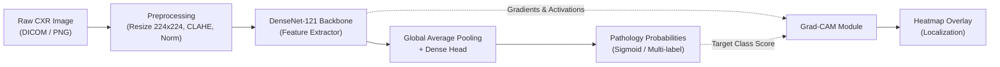

# Chest X-Ray AI Analysis: Detection & Heatmap Localization
## Student Project Blueprint & Implementation Guide

---

### 1. Executive Summary & Objective

This project aims to build an end-to-end computer-aided diagnosis (CAD) pipeline for **Chest X-ray (CXR)** analysis. Given a frontal chest radiograph (PA/AP view), the system will:
1. **Detect Pathologies**: Predict the presence of one or more thoracic diseases (multi-label classification).
2. **Localize Findings (Heatmaps)**: Generate visual explanations using **Grad-CAM** (Gradient-weighted Class Activation Mapping) to highlight anatomical regions contributing to each prediction without needing costly bounding box annotations during training.
3. **Interactive Demo**: Provide an intuitive web interface (Streamlit or Gradio) for radiograph uploads, probability outputs, and heatmap thresholding.

---

### 2. Dataset Recommendation

For a student project, access requirements, data size, and hardware limits are critical constraints:

| Dataset | Sample Size | Classes | Pros | Cons / Student Consideration |
| :--- | :--- | :--- | :--- | :--- |
| **NIH ChestX-ray14** *(Recommended for comprehensive scope)* | 112,120 images (30,805 patients) | 14 thoracic diseases | Standard benchmark; includes ~984 radiologist BBoxes for validating heatmaps; Kaggle has 5k-image sample subsets. | Full dataset is ~42 GB; requires batch downloading. |
| **Kaggle Chest X-Ray (Pneumonia)** *(Recommended for fast prototype / low compute)* | 5,856 images | 2 or 3 classes (Normal, Bacterial, Viral) | Small (~1.2 GB); quick training (1–2 hrs on Colab T4); simple binary/multiclass task. | Limited to pneumonia; less realistic clinical diversity. |
| **CheXpert (Stanford)** | 224,316 images (65,240 patients) | 14 observations | Realistic label uncertainty handling (`-1` uncertain labels); frontal + lateral views. | Requires Stanford registration; large download footprint (~11 GB downsampled). |
| **MIMIC-CXR** | 377,110 images | Multiple | Paired free-text radiology reports. | Requires formal human subjects training (CITI) and credentialed PhysioNet approval. |

> [!TIP]
> **Recommended Approach**:
> - **Primary Choice**: **NIH ChestX-ray14**. If local disk or bandwidth is limited, use the official **Kaggle NIH Chest X-ray 5% sample (~5,600 images)** to develop and debug your pipeline, then scale to the full set on Kaggle/Colab GPU if needed.
> - **Alternative**: If your deadline is under 2 weeks, use the **Kaggle Pediatric Pneumonia** dataset to focus strictly on the heatmap explainability pipeline.

---

### 3. Model & Architecture Selection

#### Backbone: DenseNet-121 (The CheXNet Standard)
- **Why DenseNet-121?**: Established as the gold standard baseline by Stanford's CheXNet (*Rajpurkar et al.*). Feature reuse through dense connectivity allows shallow gradients to flow effectively and captures both low-level bone/lung edges and high-level pathological patterns.
- **Alternatives**:
  - `ResNet-50`: Simpler architecture, slightly faster inference, well-understood Grad-CAM targets (`layer4`).
  - `EfficientNet-B0 / B2`: Low parameter count, great for edge deployment.
  - `TorchXRayVision` pre-trained models: PyTorch models pre-trained directly on millions of medical radiographs rather than ImageNet.

#### Target Layer for Grad-CAM
In DenseNet-121, extract feature maps and gradients from the final convolutional layer:
- PyTorch layer: `model.features.denseblock4.denselayer16.conv2` (or simply `model.features.norm5`).

---

### 4. Mathematical Formulation & Loss Function

#### Multi-Label Classification
A patient can have multiple conditions simultaneously (e.g., *Effusion* and *Infiltration*).
- **Activation**: Independent **Sigmoid** for each class $c \in \{1, \dots, C\}$:
  $$\hat{y}_c = \sigma(z_c) = \frac{1}{1 + e^{-z_c}}$$
- **Loss Function**: **Weighted Binary Cross-Entropy (BCE)** with Logits:
  $$\mathcal{L} = -\sum_{c=1}^{C} \left[ w_c y_c \log(\hat{y}_c) + (1 - y_c) \log(1 - \hat{y}_c) \right]$$
  Where $w_c = \frac{N_{neg, c}}{N_{pos, c}}$ balances rare positive classes like *Pneumothorax* or *Hernia*.

#### Grad-CAM Formulation
1. Compute class score $y^c$ (before sigmoid) for target disease $c$.
2. Compute gradient of $y^c$ with respect to feature activation map $A^k$ of the final conv layer:
   $$\alpha_k^c = \frac{1}{Z} \sum_{i} \sum_{j} \frac{\partial y^c}{\partial A_{i,j}^k}$$
3. Perform weighted combination and ReLU:
   $$L_{\text{Grad-CAM}}^c = \text{ReLU}\left(\sum_k \alpha_k^c A^k\right)$$

---

### 5. Implementation Roadmap (5 Phases)

#### Phase 1: Data Preparation & Hygiene
1. **Patient Leakage Prevention** *(Crucial)*: Ensure the train/validation/test split is grouped by **Patient ID**, not image index. If the same patient's scans appear in both train and test sets, the model learns patient identity rather than pathology.
2. **Preprocessing**:
   - Resize to $224 \times 224$ or $512 \times 512$ (preserve aspect ratio with padding or center crop).
   - Convert grayscale to 3-channel (RGB duplication) to match standard pre-trained backbones.
   - Contrast Limited Adaptive Histogram Equalization (**CLAHE**) to enhance soft tissue and bone contrasts.
   - Augmentations: Random affine (slight rotation $\pm 10^\circ$, translation $\pm 5\%$, horizontal flip—*note: check situs inversus/dextrocardia implications*).

#### Phase 2: Model Training & Tuning
1. Initialize DenseNet-121 with ImageNet or TorchXRayVision weights.
2. Replace classifier head: `Linear(in_features=1024, out_features=14)`.
3. Optimizer: AdamW (`lr=1e-4`, weight decay `1e-4`), ReduceLROnPlateau scheduler.
4. Mixed precision training (`torch.cuda.amp.autocast`) to speed up execution and reduce GPU memory usage.

#### Phase 3: Grad-CAM Explainability Engine
1. Register forward and backward hooks on the last feature layer.
2. Generate heatmap $H \in \mathbb{R}^{7 \times 7}$ for target class $c$.
3. Bilinearly upsample $H$ to image dimensions ($224 \times 224$).
4. Apply colormap (e.g., `cv2.COLORMAP_JET`) and alpha-blend with original grayscale image ($0.4 \cdot \text{heatmap} + 0.6 \cdot \text{image}$).

#### Phase 4: Quantitative & Qualitative Evaluation
- **Classification Metrics**:
  - Per-class AUROC (Area Under ROC Curve).
  - Mean AUROC (mAUROC) across all pathologies.
  - Optimal threshold determination via Youden's Index ($J = \text{Sensitivity} + \text{Specificity} - 1$).
- **Heatmap Validation**:
  - Compare generated heatmaps against NIH bounding box annotations (IoU at threshold $\tau$, or pointing game accuracy).

#### Phase 5: Interactive Web Application
- Build a lightweight UI using **Gradio** or **Streamlit**:
  - Drag-and-drop CXR upload.
  - Dropdown to select detected disease or "Top Predicted Disease".
  - Slider to adjust Grad-CAM transparency / threshold cutoff.
  - Side-by-side comparison: Original Scan vs. Heatmap Overlay.

---

### 6. Recommended Technology Stack

| Category | Recommended Tool | Purpose |
| :--- | :--- | :--- |
| **Framework** | **PyTorch** + **Torchvision** | Flexible hook registration for Grad-CAM; high community adoption. |
| **Explainability** | `pytorch-grad-cam` or Custom Hooks | Fast implementation of Grad-CAM / Grad-CAM++ / HiResCAM. |
| **Medical Imaging Utils** | `pydicom` / `torchxrayvision` | Handling DICOM metadata and specialized medical weights. |
| **Augmentation** | `albumentations` | Fast image transforms (CLAHE, rotations, brightness shifts). |
| **Tracking / Metrics** | `scikit-learn` + `Weights & Biases` | AUROC calculation and experiment monitoring. |
| **User Interface** | **Gradio** or **Streamlit** | Interactive clinician-style diagnostic demo. |
| **Compute** | Google Colab (T4/V100) / Kaggle Kernels | Free GPU access with persistent datasets. |

---

### 7. Pitfalls & Common Mistakes in Student Projects

> [!WARNING]
> 1. **Data Leakage Across Splits**: Splitting simply with `train_test_split(df)` leaks patients across train and validation sets, artificially inflating AUROC by 5–15%. Use `GroupKFold` or split on `Patient ID`.
> 2. **Shortcuts & Confounders**: Models can latch onto non-clinical artifacts (e.g., radiological lead letters "L" / "R", chest tubes, pacemaker hardware, hospital-specific border markings) rather than internal pathology. Grad-CAM will reveal this immediately!
> 3. **Improper View Mixing**: Ensure you inspect whether an image is PA (Posteroanterior) or AP (Anteroposterior). AP views naturally cause cardiac magnification, which can mislead models into predicting false cardiomegaly.
> 4. **Threshold Selection**: Default probability threshold $0.5$ is usually suboptimal for imbalanced medical data. Tune thresholds per pathology on the validation set.
